<p align="center">
  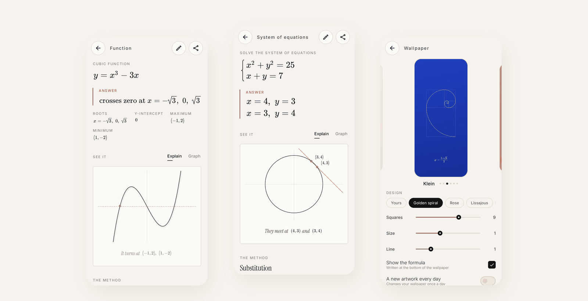
</p>

<h1 align="center">MathLens</h1>

<p align="center">
  <em>Point your camera at a problem. See it solved, explained and drawn.</em>
</p>

<p align="center">
  
  
  
  
</p>

---

MathLens reads handwritten or printed mathematics with the camera and solves it on your phone, step by step,
with an animated explanation of *why* each step works. Everything runs locally: no account, no cloud, no tracking.

The solver is a portable C++23 library with no dependencies, so the same engine can power other platforms.

## Highlights

- **Reads what you point at.** Hold the phone steady over a problem and it reads by itself, whether handwritten in a notebook, printed or on a screen. Systems of equations work too, braced or line by line.
- **Every step, explained.** Several methods side by side (factoring, the quadratic formula, completing the square…). Each line highlights what changed, and any step expands into *why*.
- **See the mathematics.** Hand-drawn style animations: the balance scale of a linear equation, tangents gliding along a curve, areas filling under an integral, a matrix bending the plane.
- **Graphs that think.** Roots, turning points and intersections are marked and labelled. Parameters like `a` and `b` in `y = a·sin(b·x)` get sliders. Graphs can be saved to a gallery.
- **Well beyond homework.** Calculus, limits, Taylor series, ODEs, complex numbers, matrices up to 20×20 and 3D arrays, statistics, and quantitative finance models such as Black–Scholes, Merton and binomial trees.
- **Math as art.** A wallpaper studio turns equations, or classics like the golden spiral and the times-table cardioid, into wallpapers, and can give you a new one every day.
- **History, favourites, PDF.** Search past problems, star the ones worth keeping, and export any solution as a clean PDF.

## Screenshots

<table>
  <tr>
    <td align="center">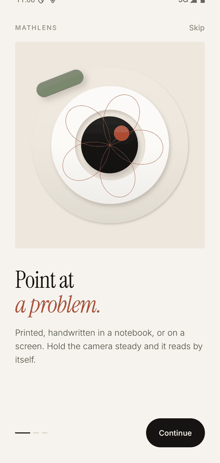<br><sub>Point at a problem</sub></td>
    <td align="center">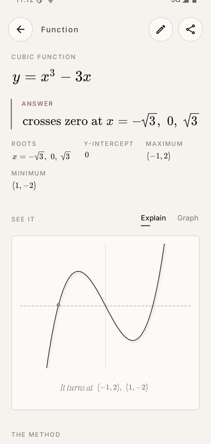<br><sub>Roots and turning points</sub></td>
    <td align="center">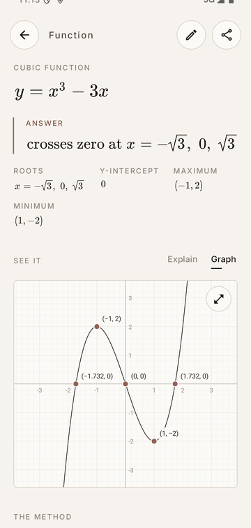<br><sub>Labelled graph</sub></td>
    <td align="center">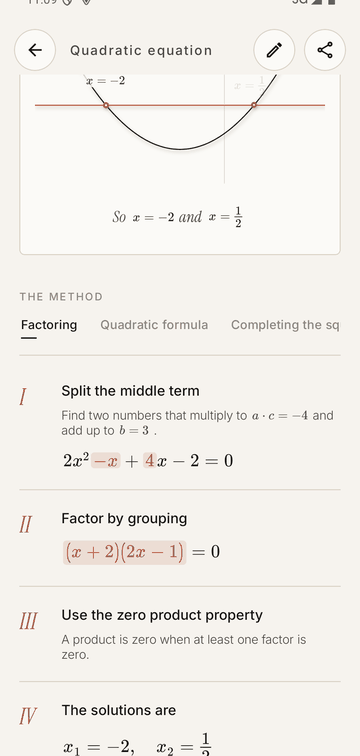<br><sub>Steps that highlight changes</sub></td>
  </tr>
  <tr>
    <td align="center">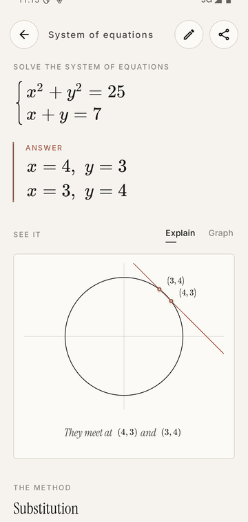<br><sub>Systems, drawn</sub></td>
    <td align="center">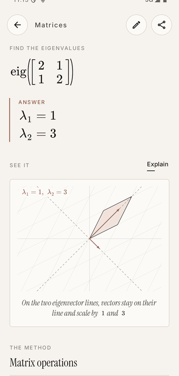<br><sub>A matrix bends the plane</sub></td>
    <td align="center">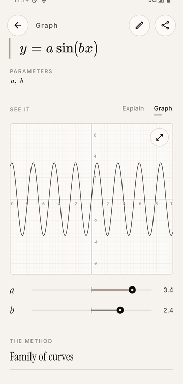<br><sub>Families of curves</sub></td>
    <td align="center">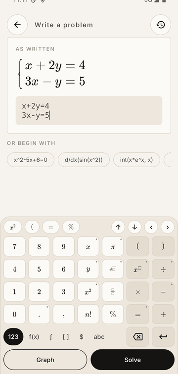<br><sub>A keyboard for math</sub></td>
  </tr>
  <tr>
    <td align="center">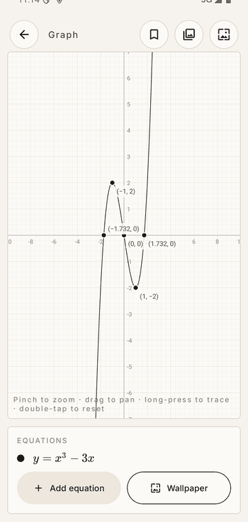<br><sub>Full-screen graph</sub></td>
    <td align="center">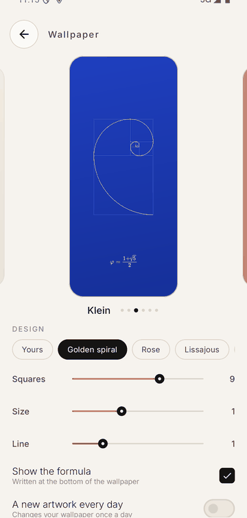<br><sub>Wallpaper studio</sub></td>
    <td align="center">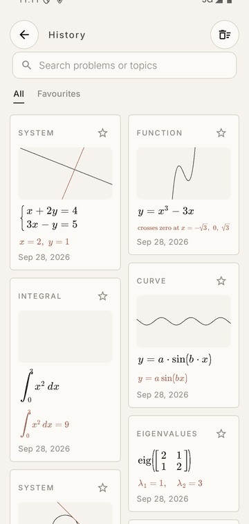<br><sub>History and favourites</sub></td>
    <td align="center">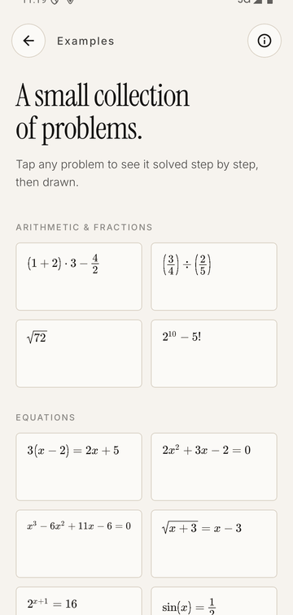<br><sub>Examples</sub></td>
  </tr>
</table>

## What it solves

| Area | Examples |
|---|---|
| Arithmetic and fractions | `(3/4) ÷ (2/5)`, `sqrt(72)`, `20!`, `gcd(48, 18)` |
| Equations | linear, quadratic (three methods), polynomial, rational, radical, absolute value, exponential, trigonometric |
| Inequalities and systems | `x^2 - 4 < 0`, `x + y + z = 6; 2x - y + z = 3; x + 2y - z = 2`, nonlinear systems |
| Curves | conics identified by their geometry, polar roses and cardioids, functions read for roots, turning points and end behaviour |
| Calculus | derivatives, integrals (definite and indefinite, verified numerically), limits, Taylor series, differential equations, surfaces `z = f(x, y)` |
| Complex numbers | arithmetic, polar and exponential forms, complex roots on the Argand plane |
| Matrices | products, determinants, inverses, row reduction, eigenvalues up to 20×20, 3D arrays (`shape`, `sum`, `slice`) |
| Statistics and finance | summary statistics, future and present value, NPV and IRR, bonds, Sharpe ratio, Black–Scholes(–Merton), jump diffusion, credit model, binomial trees, implied volatility |

Every answer to an equation is substituted back into the original before it is shown.

## How it works

```
 camera frame ──► pix2text-MFR (ONNX Runtime, on device) ──► LaTeX
                                                               │
 keyboard ─────────────────────────────────────────────► engine syntax
                                                               │
                                      C++23 math engine  ◄─────┘
                         parse · simplify · solve · verify · explain
                                                               │
                                        Solution JSON (steps, facts, plot, story)
                                                               │
                              Kotlin / Jetpack Compose UI ◄─────┘
                    steps · Explain animations · graphs · PDF · wallpapers
```

- **`mathengine/`**: the solver. Exact rational arithmetic (arbitrary precision), an expression tree with a simplifier, dedicated solvers per area, a step writer, and a C API (`me_solve`, `me_graph`, `me_from_latex`…) that returns JSON. No exceptions, no dependencies.
- **`android/`**: the app. Jetpack Compose UI, CameraX, a native LaTeX renderer, and the JNI bridge to the engine.

## Build

**Requirements:** a C++23 compiler (GCC 13+ or Clang 17+), CMake 3.22+, and for the app Android Studio with JDK 17 or 21, Android SDK 36 and NDK 30.

### The engine

```bash
cmake -S mathengine -B mathengine/build -DCMAKE_BUILD_TYPE=Release
cmake --build mathengine/build -j
./mathengine/build/mathtests                        # the test suite
./mathengine/build/mathcli --json "x^2 - 5x + 6 = 0" # solve anything from the shell
```

### The app

Open `android/` in Android Studio and run, or from the command line:

```bash
cd android
./gradlew assembleDebug        # app/build/outputs/apk/debug/app-debug.apk
./gradlew installDebug         # onto a connected device or emulator
```

The engine is compiled into the app automatically through CMake.

## The recognition model

Handwriting and print recognition uses **[pix2text-MFR 1.5](https://huggingface.co/breezedeus/pix2text-mfr-1.5)** by
**[breezedeus](https://github.com/breezedeus)**, released under the MIT License. Many thanks to the author for making an
excellent mathematical formula recognizer freely available. See also the wider
[Pix2Text](https://github.com/breezedeus/Pix2Text) project.

The app ships the model quantized to int8 (about 32 MB) in `android/app/src/main/assets/ocr/`. To rebuild those files
from the upstream release:

```bash
python3 -m venv .venv && . .venv/bin/activate
pip install huggingface_hub onnx onnxruntime
python3 tools/model/prepare_model.py
```

The script downloads the upstream ONNX encoder and decoder, applies dynamic int8 quantization with ONNX Runtime, and
writes the token vocabulary. The output is byte-for-byte identical to the files in this repository.

## Project layout

```
mathengine/            portable C++23 solver (GPL-3.0-or-later)
  include/mathengine/  public C API
  src/                 core · parse · algebra · calculus · arithmetic · complex · matrix · solution · api
  tests/  cli/         test suite and command-line tool
android/               Android app (MIT)
  app/src/main/java/   Compose UI, camera, graphs, Explain scenes, wallpapers, PDF export
  app/src/main/cpp/    JNI bridge
  app/src/main/assets/ recognition model and license texts
tools/model/           reproduces the recognition model files
tools/dev/             helpers for driving the app on an emulator
docs/screenshots/      images used here
```

## Contributing

Contributions are welcome, from new solvers and explanations to translations and design polish.
Please read **[CONTRIBUTING.md](CONTRIBUTING.md)** for the workflow, code style and commit format.
In short: open an issue to discuss larger changes, keep pull requests focused, add a test for every engine change, and
test UI changes on a device or emulator.

## Future work

- More explanations for trigonometric identities and the unit circle
- Word problems and units
- iOS and web builds on top of the same C++ engine (WebAssembly)
- Localisation into more languages
- A signed release on app stores

## License

- The **math engine** (`mathengine/`) is licensed under the **GNU General Public License v3.0 or later**.
- The **Android app code** (`android/`) and tools are licensed under the **MIT License**.

Because the app includes the engine, the app as distributed is covered by the GPL v3: you are free to use, study, change
and share it, and derivative works must stay open under the same terms. See [LICENSE](LICENSE),
[mathengine/LICENSE](mathengine/LICENSE), [android/LICENSE](android/LICENSE) and
[THIRD_PARTY_NOTICES.md](THIRD_PARTY_NOTICES.md).

## Acknowledgements

- [pix2text-MFR](https://huggingface.co/breezedeus/pix2text-mfr-1.5) by breezedeus: the recognition model
- [ONNX Runtime](https://github.com/microsoft/onnxruntime): on-device inference
- [KaTeX](https://katex.org) fonts: mathematical typesetting
- [Instrument Serif](https://github.com/Instrument/instrument-serif) and [Inter](https://github.com/rsms/inter): typefaces
